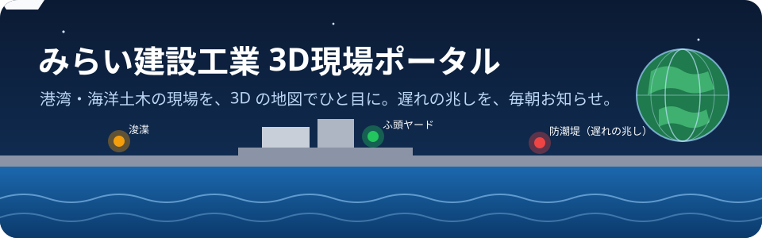
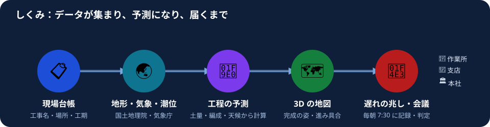
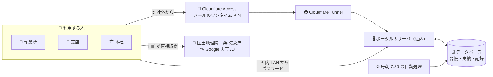
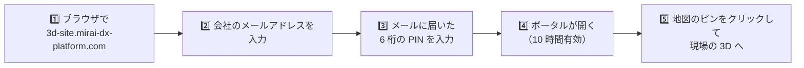
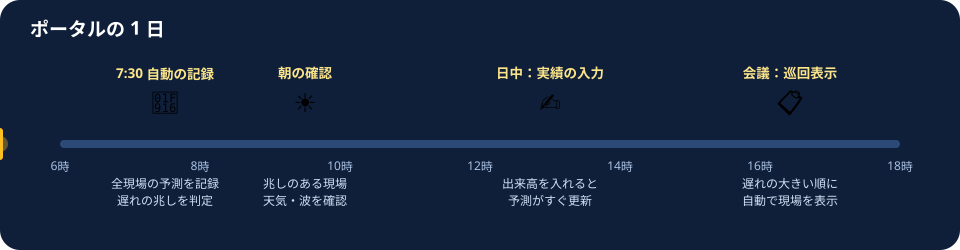
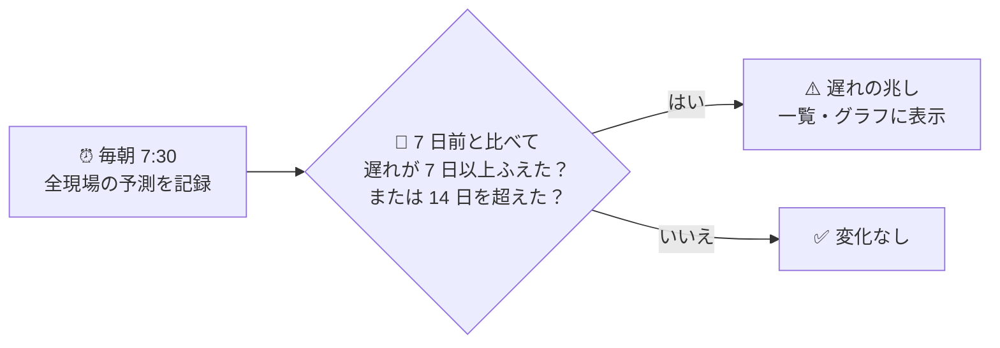
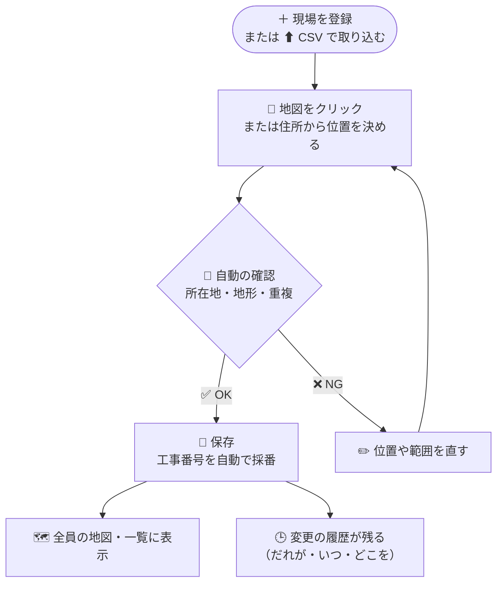
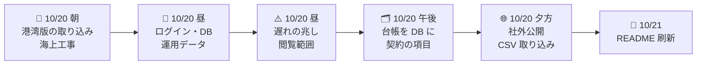

<p align="center">
  
</p>

<p align="center">
      
</p>

<p align="center">
  <b>港湾・海洋土木の現場を、3D の地図でひと目に。遅れの兆しを、毎朝お知らせ。</b><br>
  みらい建設工業の作業所・支店・本社が、同じ地図と同じ数字で現場の状況を共有するための社内ポータルです。
</p>

---

## 📑 目次

| | 非エンジニア向け | | 技術者向け |
|---|---|---|---|
| 🌟 | [概要](#-概要) | 🛠 | [技術者向けの資料](#-技術者向けの資料) |
| 🎯 | [目的と意義](#-目的と意義) | 📁 | [ファイル](#ファイル) |
| 🧭 | [しくみ](#-しくみ) | 🖥 | [サーバ版（ログイン・データベース）](#サーバ版ログインデータベース) |
| 🧰 | [できること](#-できること) | 🌐 | [オンライン版が取得するデータ](#オンライン版が取得するデータ) |
| 👥 | [使う人と権限](#-使う人と権限) | 🔧 | [作り直し方](#作り直し方tools) |
| 🚪 | [はじめての方へ（使い方）](#-はじめての方へ使い方) | ✅ | [検証結果](#検証結果) |
| 🗓 | [ポータルの 1 日](#-ポータルの-1-日) | 📝 | [更新履歴](#-更新履歴) |
| 🏗 | [現場の登録](#-現場の登録) | | |
| 🔒 | [安全のための取り組み](#-安全のための取り組み) | | |
| 📌 | [いまの状態とこれから](#-いまの状態とこれから) | | |
| ❓ | [よくある質問](#-よくある質問) | | |

---

## 🌟 概要

**3D現場ポータル**は、ブラウザで開く社内向けの Web サービスです。全国の港湾・海岸・海上の工事現場を、**日本地図と 3D の地形の上**に並べて表示します。

| 🔍 見えるもの | 内容 |
|---|---|
| 🗾 全国の現場 | 支店・工種・発注者で絞り込んで、地図の上で一覧 |
| 🏗 現場ごとの 3D | 完成したときの姿、いまの進み具合、周辺の地形 |
| 📈 工程の予測 | 土量・重機の編成・天候から計算した**竣工の予測**と**遅れの日数** |
| 🌊 海の情報 | 天気・風・**波**、**潮位**と干潮の時間帯、津波・高潮の浸水想定 |
| ⚠️ 遅れの兆し | 毎朝 7:30 に全現場を記録し、**遅れが急に増えた現場**を知らせる |

> 🌐 **入口**：`https://3d-site.mirai-dx-platform.com/`（社外からも利用可。メールに届くワンタイム PIN でサインイン）
> 🏢 **社内 LAN**：`http://192.168.0.185:36621/`（パスワードでログイン）

---

## 🎯 目的と意義

### 目的

1. **現場の「いま」と「これから」を、全員が同じ画面で共有する**
2. **遅れを早く見つけ、手を打つ時間をつくる**
3. **港湾・海洋土木ならではの条件（潮・波・海底）を、計画と判断に組み込む**

### 意義（これまでとの違い）

| 場面 | 😣 これまで | 😊 ポータルを使うと |
|---|---|---|
| 支店会議 | 現場ごとに資料を集め、紙やスライドで説明 | 📋 **会議巡回**：遅れの大きい順に、3D と分析を自動で切り替えて表示 |
| 遅れの把握 | 月の締めや報告で、遅れが表に出たときには手遅れ気味 | ⚠️ **毎朝の自動判定**で、遅れが増え始めた段階で気づける |
| 海上作業の段取り | 潮位表・波の予報・工程表を別々に見比べる | 🌊 **作業可能日**：潮位×波×工程を重ねて、日ごとに「適／不適」 |
| 発注者・漁協への説明 | 図面や平面図で説明し、完成の姿が伝わりにくい | 🗣 **説明モード**：完成後の姿と工程だけを 3D で見せる（社内の数字は出さない） |
| 似た工事の参考 | 担当者の記憶や過去の資料を探す | 📊 **類似工事**：同じ工種・規模の工期・能力を表とグラフで比較 |
| 情報の置き場所 | 現場・支店ごとの Excel や紙に分散 | 🗄 **現場台帳を 1 か所（データベース）に**。だれが・いつ変えたかも残る |

---

## 🧭 しくみ

<p align="center">
  
</p>

- **📋 現場台帳**：工事名・場所・工種・工期などを、画面から登録します（CSV でまとめて取り込むこともできます）。
- **🌏 外部のデータ**：地形・住所は**国土地理院**、天気・波・潮位は**気象庁**から、その都度取得します。ファイルにデータを抱え込みません。
- **🧠 工程の予測（ワールドモデル）**：土量・重機の編成・雨や冬の休み・実績から、竣工日を計算します。実績を入れるほど予測が現場に合っていきます。
- **🗺 3D と 📣 お知らせ**：結果を 3D の地図・一覧・グラフで見せ、毎朝の記録から遅れの兆しを判定します。

<details>
<summary>🌐 <b>全体の構成図を見る</b>（クリックで開く）</summary>



</details>

---

## 🧰 できること

| | 機能 | どんなときに使う？ | おもに使う人 |
|---|---|---|---|
| 🗾 | **全国の地図と現場の一覧** | 支店・工種・発注者で絞り込み、気になる現場へ飛ぶ | 全員 |
| 🏗 | **現場の 3D** | 完成の姿・切土と盛土・周辺の地形を確かめる | 作業所・支店 |
| 📈 | **工程管理・遅れの分析** | 竣工の予測、遅れの理由、挽回の編成案（最大 3 案）を見る | 作業所・支店 |
| ✍️ | **実績の入力** | 工程ごとの出来高を入れて、予測を現場に合わせる | 作業所（編集者） |
| ⚠️ | **遅れの兆し** | 毎朝の記録で、1 週間で遅れが急に増えた現場を見つける | 支店・本社 |
| 🌦 | **気象・海象** | 天気・風・波・警報と、作業中止の目安を見る | 作業所 |
| 🌊 | **潮位・作業可能日** | 干潮の時間帯、潮位×波×工程で「作業に適した日」を探す | 作業所 |
| 🚢 | **配船計画** | 作業船の割り当てと稼働率。同じ船の重複は自動で止める | 支店 |
| 📐 | **測量の比較** | 深浅測量を日付ごとに登録し、残り土量・出来形を色分け | 作業所 |
| 🤝 | **協議・区域** | 漁協・港湾管理者との協議記録、作業区域・航路を地図に描く | 作業所・支店 |
| 📋 | **会議巡回** | 支店会議で、遅れの大きい順に自動で現場を切り替える | 支店 |
| 🗣 | **説明モード** | 発注者・漁協向けに、完成の姿と工程だけを見せる | 作業所・支店 |
| 📄 | **会議資料・現場概要の印刷** | PDF に保存して配る | 支店 |
| 📊 | **類似工事の比較** | 同じ工種・規模の工事と工期・能力を比べる | 本社（総合評価） |
| 🗂 | **現場台帳の登録・取り込み** | 地図で位置を決めて登録、CSV でまとめて取り込み | 編集者・管理者 |

---

## 👥 使う人と権限

| 権限 | 👀 見る | ✍️ 実績・台帳の入力 | ⚙️ 設定・利用者の管理 | なり方 |
|---|:---:|:---:|:---:|---|
| 🟢 **閲覧者** | ✅ | — | — | `@mirai-const.co.jp` の人は、初めてサインインしたときに自動で閲覧者になります |
| 🟡 **編集者** | ✅ | ✅ | — | 管理者が権限を変えます |
| 🔴 **管理者** | ✅ | ✅ | ✅ | DX 推進部が指定します |

- **🏢 支店ごとの閲覧範囲**：利用者ごとに「見られる支店」を絞れます（既定は全支店）。範囲の外の現場は一覧にも出ません。

---

## 🚪 はじめての方へ（使い方）



| 手順 | 操作 | ひとこと |
|:---:|---|---|
| 1 | ブラウザ（Chrome・Edge）で `https://3d-site.mirai-dx-platform.com/` を開く | スマートフォンでも見られます |
| 2 | 会社のメールアドレス（`@mirai-const.co.jp`）を入れる | パスワードは要りません |
| 3 | メールに届いた PIN を入れる | 届かないときは迷惑メールを確認 |
| 4 | 3D の読み込みを待つ（初回は数十秒） | 「読み込んでいます…（○秒）」と経過が出ます |
| 5 | 地図のピン、または左の一覧から現場を選ぶ | `Esc` キーで全国の表示に戻ります |

> 💡 詳しい操作は `みらい建設工業_3D現場ポータル_利用手順書.html` をご覧ください。

---

## 🗓 ポータルの 1 日

<p align="center">
  
</p>



- 判定の日数は、管理者が ⚙ 設定で変えられます。
- 記録が 7 日分たまってから判定を始めます（過去にさかのぼって記録は作りません）。
- 📧 メールでのお知らせの仕組みもありますが、**いまは無効**です（有効にするには別途の承認が要ります）。

---

## 🏗 現場の登録



| 登録の方法 | 向いている場面 | 場所 |
|---|---|---|
| ＋ **現場を登録** | 1 件ずつ、地図で位置と範囲を決めて登録 | 画面上部・地図のボタン列 |
| ⬆ **台帳を取り込む（CSV）** | 何件かをまとめて登録（Excel で記入した CSV も可） | 「＋ 現場を登録」の隣 |
| ✎ **台帳を編集** | 登録した内容や契約の項目（工期・JV など）を直す | 現場のサマリ |

- 分からない値は**推測で埋めません**。仮の値には「要確認」と表示されます。
- 契約の項目は、根拠の資料と照らし合わせたら項目ごとに「確認済み」にできます。

---

## 🔒 安全のための取り組み

| | 取り組み | 内容 |
|---|---|---|
| 🔐 | **入口の認証** | 社外からは Cloudflare Access のワンタイム PIN。許可されたアドレスだけが通れます |
| 🧑‍💼 | **二重の確認** | Access を通っても、ポータルに登録された利用者でなければ入れません |
| 🏢 | **閲覧範囲** | 支店ごとに見られる現場を絞れます |
| 🕒 | **履歴** | 台帳・実績の変更は、だれが・いつ・何を変えたかが残ります |
| 🔑 | **秘密の管理** | パスワード・鍵はリポジトリに入れません。パスワードは暗号学的に安全な方式（Argon2id）で保存します |
| 💾 | **バックアップ** | データベースの変更の前に、必ずバックアップを取ります |
| 🧪 | **検査** | 変更のたびに自動の検査（CI）とブラウザでの動作確認を通してから反映します |

---

## 📌 いまの状態とこれから

| 状態 | 項目 | メモ |
|---|---|---|
| ✅ 稼働中 | 公開（`3d-site.mirai-dx-platform.com`）・ワンタイム PIN | 社内 LAN からも利用可 |
| ✅ 稼働中 | 現場台帳の登録・編集・CSV 取り込み | 架空のサンプル現場は削除済み。**実際の現場を登録していく段階** |
| ✅ 稼働中 | 毎朝 7:30 の記録と遅れの兆しの判定 | 現場が 0 件の日は何もしません |
| 🟡 準備中 | 社内の工事コードとの連携 | 社内の情報ハブ（Mirai-Info）がデータの配信を開始。ポータル側の受け口はこれから |
| 🟡 準備中 | 実際の現場の登録 | 会社の施工実績から作った候補一覧あり |
| ⏸ 未決 | メールでのお知らせ | SMTP の情報と承認が必要 |
| ⏸ 未決 | desknet's NEO への掲示 | API の仕様の確認待ち |
| ⏸ 未決 | 作業船の位置（AIS） | 受信の手段が未定（いまの作業船はデモ） |
| ⏸ 未決 | 社内 LAN の入口を閉じるか | ワンタイム PIN だけにするかの判断 |

---

## ❓ よくある質問

<details>
<summary>🐢 <b>開くのに時間がかかります</b></summary>

初回は 3D の部品と、現場ごとの地形（国土地理院）を取得するため、数十秒かかることがあります。画面に「読み込んでいます…（○秒）」と経過が出ます。止まったように見えるときは、ページを読み込み直してください。
</details>

<details>
<summary>📨 <b>PIN のメールが届きません</b></summary>

迷惑メールのフォルダを確認してください。PIN の有効期限は短いので、届かないときはもう一度メールアドレスを入れ直してください。許可されていないアドレスには届きません。
</details>

<details>
<summary>🗺 <b>街並みが写真のような 3D になりません</b></summary>

Google 実写3D は、Google のキーが有効なときだけ表示されます。キーが無いときは、国土地理院の地図と地形で表示する「簡易地形モード」になります（右上に表示）。
</details>

<details>
<summary>✍️ <b>実績や台帳を入力するボタンがありません</b></summary>

入力は編集者・管理者だけができます。閲覧者のときは、管理者に権限の変更を依頼してください。
</details>

<details>
<summary>📅 <b>「基準日 2026/10/06」とは何ですか？</b></summary>

工程の予測の起点となる日（実績の最終観測日）です。いまはサンプルの日付のままで、実際の現場もこの日を基準に予測しています（今後の改善項目です）。
</details>

---

## 📝 更新履歴



| 日時 | 版 | 種類 | 内容 |
|---|---|---|---|
| 2026-10-21 | — | 📘 文書 | README を非エンジニア向けに刷新（概要・目的・意義、図とアニメーション、更新履歴） |
| 2026-10-20 17:53 | [#22](https://github.com/Kensan196948G/3D-Portal-Google3D/pull/22) | ✨ 機能 | CSV 取り込みで「出典の URL」とメモを台帳に残す |
| 2026-10-20 17:33 | [#21](https://github.com/Kensan196948G/3D-Portal-Google3D/pull/21) | 🐛 修正 | 記入の無い CSV を選んだときに理由を表示 |
| 2026-10-20 17:28 | [#20](https://github.com/Kensan196948G/3D-Portal-Google3D/pull/20) | ✨ 機能 | 現場台帳の CSV 取り込み（Shift_JIS 可・住所から位置・所在地と地形の確認） |
| 2026-10-20 17:06 | [#19](https://github.com/Kensan196948G/3D-Portal-Google3D/pull/19) | 🐛 修正 | 画面のファイルを版付きの URL で読み込み、古い版が残らないように |
| 2026-10-20 16:49 | [#18](https://github.com/Kensan196948G/3D-Portal-Google3D/pull/18) | ✨ 機能 | タブのアイコンを色付きの地球に。現場の登録の入口を増やす |
| 2026-10-20 16:37 | [#17](https://github.com/Kensan196948G/3D-Portal-Google3D/pull/17) | 🔐 承認 | 社内ドメインの人を、初回のサインインで閲覧者として自動登録 |
| 2026-10-20 16:23 | [#16](https://github.com/Kensan196948G/3D-Portal-Google3D/pull/16) | 🐛 修正 | 画面のファイルを途中の CDN にキャッシュさせない・トンネルを HTTP/2 に |
| 2026-10-20 15:58 | [#15](https://github.com/Kensan196948G/3D-Portal-Google3D/pull/15) | 🐛 修正 | 3D の部品を並行して読み込み、ログイン画面を先に表示 |
| 2026-10-20 15:48 | [#14](https://github.com/Kensan196948G/3D-Portal-Google3D/pull/14) | 🐛 修正 | サインインの案内をワンタイム PIN に合わせる |
| 2026-10-20 15:45 | [#13](https://github.com/Kensan196948G/3D-Portal-Google3D/pull/13) | 🔐 承認 | `3d-site.mirai-dx-platform.com` で社外公開（Cloudflare Tunnel） |
| 2026-10-20 15:34 | [#12](https://github.com/Kensan196948G/3D-Portal-Google3D/pull/12) | ✨ 機能 | 台帳に契約の項目（契約工期・受注区分・JV・発注機関・出典と確認状態） |
| 2026-10-20 15:24 | [#11](https://github.com/Kensan196948G/3D-Portal-Google3D/pull/11) | ✨ 機能 | 架空のサンプル現場を削除できるように（本番から削除済み） |
| 2026-10-20 13:48 | [#10](https://github.com/Kensan196948G/3D-Portal-Google3D/pull/10) | ✨ 機能 | 現場台帳をデータベースの正に。地図で現場を登録・編集 |
| 2026-10-20 12:25 | [#8](https://github.com/Kensan196948G/3D-Portal-Google3D/pull/8) | 🔐 承認 | 支店ごとの閲覧範囲と Cloudflare Access でのログイン |
| 2026-10-20 12:06 | [#9](https://github.com/Kensan196948G/3D-Portal-Google3D/pull/9) | 📘 文書 | 仕様書・利用手順書・運用管理手順書を更新 |
| 2026-10-20 11:41 | [#7](https://github.com/Kensan196948G/3D-Portal-Google3D/pull/7) | 🐛 修正 | 遅れの兆しのレビュー指摘への対応 |
| 2026-10-20 11:20 | [#6](https://github.com/Kensan196948G/3D-Portal-Google3D/pull/6) | ✨ 機能 | 遅れの兆し（毎朝の記録・前週比の判定・メールの送信経路） |
| 2026-10-20 10:52 | [#5](https://github.com/Kensan196948G/3D-Portal-Google3D/pull/5) | ✨ 機能 | 配船計画・測量の比較・協議記録と作業区域 |
| 2026-10-20 10:09 | [#4](https://github.com/Kensan196948G/3D-Portal-Google3D/pull/4) | ✨ 機能 | 作業可能日（潮位×波×工程）・類似工事・支店会議資料 |
| 2026-10-20 09:36 | [#3](https://github.com/Kensan196948G/3D-Portal-Google3D/pull/3) | 🔐 承認 | ログイン（メール＋パスワード）とデータベース |
| 2026-10-20 08:56 | [#2](https://github.com/Kensan196948G/3D-Portal-Google3D/pull/2) | ✨ 機能 | 海上工事（航路浚渫・海面埋立）と深浅測量の取り込み |
| 2026-10-20 08:38 | [#1](https://github.com/Kensan196948G/3D-Portal-Google3D/pull/1) | ✨ 機能 | 会議巡回・説明モード・潮位・浸水想定・遅れの分析 |
| 2026-10-20 08:26 | — | 🌱 開始 | みらい建設工業 3D現場ポータル（港湾・海洋土木版）の初期取り込み |

> 種類：✨ 機能の追加　🐛 修正　🔐 承認が必要な変更（認証・公開・権限）　📘 文書　🌱 開始

---

## 🛠 技術者向けの資料

> ここから下は、開発・運用の担当者向けの詳しい資料です。開発の途中で使った**架空のサンプル現場**（17 件）に関する記述が残っていますが、それらは 2026-10-20 に本番から削除済みです。

利用するのは**オンライン版（`online/` フォルダ）とサーバ版（`server/`）**です。地形・所在地・地図・気象などのデータは、起動のたびにオンラインで取得します。インターネットにつながらない場所では、オフライン版（`みらい建設工業_3D現場ポータル_オフライン版.html`）を使えます。

`3D-Portal-Google3D-offline/` にある「3D現場ポータル Google 3D版」（原本）を、みらい建設工業の業務に合わせて**新規に作り直した版**です。原本のファイルは変更していません。情報区分は「社内」です。

### ファイル

このフォルダ（`3D-Portal-Google3D/`）がルートです。コマンドはこのフォルダで実行します。

| ファイル | 内容 |
|---|---|
| `online/` | **オンライン版（利用版）**。`index.html`・`loader.js`・`app.js`・`data/`。起動時にすべてのデータをオンラインで取得する（下記）。CesiumJS＋国土地理院の地図、APIキーがあれば Google 実写3D |
| `みらい建設工業_3D現場ポータル_オフライン版.html` | オフライン版（予備）。単一HTML・約1.3MB。外部と通信しない。3D描画は three.js を埋め込み |
| `みらい建設工業_3D現場ポータル.html` | 埋め込み版。オンライン版とオフライン版を作る元（データをファイルに埋め込み、CesiumJS で描く）。単体でも動く |
| `みらい建設工業_3D現場ポータル_詳細仕様書.html` | 詳細仕様書 |
| `みらい建設工業_3D現場ポータル_利用手順書.html` | 利用手順書（支店工事部・作業所・本社向け） |
| `みらい建設工業_3D現場ポータル_運用管理手順書.html` | 運用管理手順書（DX推進部向け） |
| `src/online_loader.js` | オンライン版の起動時のデータ取得（`online/loader.js` の元） |
| `src/offline_renderer.js` | オフライン版の3D描画（10〜12章）。オフライン版だけの部分 |
| `tools/` | 生成・検証ツール（下記） |
| `3D-Portal-Google3D-offline/` | 原本（3D現場ポータル Google 3D版と、その文書3本）。読むだけで変更しない |

### 業務機能（オンライン版）

- **気象・海象タブ**（気象庁）：現場の市区町村に当たる予報区域の天気・風・**波**、発表中の**警報・注意報**、**作業判断の目安**（水際の工種は波の高さ 注意 1.5m／中止 2.5m。`data/master.json` の `marine` で変更）。台帳に「⚠気象／⚠中止目安」、絞り込みに「気象注意」、全社サマリに件数。いまの実際の予報で、工程の計算（基準日 2026-10-06 の架空データ）には入れない
- **実績入力（デモ）タブ**：工程ごとの出来高を入れると、実効率 η を較正し直して竣工予測・遅延・3D が変わる。保存は**このブラウザだけ**（サーバへは送らない）。JSON で書き出し・読み込み
- **CSV 出力**：ポートフォリオの「CSV 出力」で台帳を Excel 向け CSV（BOM 付き・数式にならない処理）で保存
- **会議巡回**（📋）：支店会議用に、いまの絞り込みの現場を遅れの大きい順に自動で巡回（1現場 10〜60 秒、遅れの分析タブを表示）。画面を触ると一時停止、Esc で終了
- **説明モード**（🗣）：発注者・漁協・港湾利用者などへの説明用。完成後の姿（3D）と工程（計画）だけを表示し、遅れ・実績・工事番号・社内の絞り込みは出さない
- **潮位タブ**（気象庁 潮位表）：最寄りの潮位表地点の推算潮位、満潮・干潮、**干潮時の作業時間帯**（平均海面より 20cm 以上低い時間＝サンプル値。`data/master.json` の `marine.tideWork`）。「1日の潮位を再生」で 3D に潮位面を出して動かす（T.P. への換算は気象庁の MSL 標高、不明な地点は MSL≒T.P. の概算）
- **浸水想定**（全国表示のレイヤー）：国土地理院 ハザードマップポータルの津波浸水想定・高潮浸水想定区域を地図に重ねる（Google 実写3D の表示中は自動で地理院地図に切り替え）
- **作業船**（レイヤー）：作業船の位置を全国・現場の 3D に表示。**いまはデモ（架空の船・架空の動き）で、AIS は未接続**
- **遅れの分析タブ**：竣工予測と、遅れの理由（実績の遅れ・実効率・ボトルネック・冬期・雨天・搬入土）を計算から文章にし、遅れを取り戻す編成（台数・稼働時間・稼働日）を予測し直して3案まで提案。「試す」で What-if
- **作業可能日タブ**：最寄りの潮位表（気象庁）と波の予報（気象庁・約3日）と工程の予測を重ね、日ごとに「適／潮位のみ適（波は前日に再確認）／不適」を判定。基準は「ケーソン据付」「干潮時の作業」「海上作業（一般）」の3つ（サンプル値。`data/master.json` の `marine.workCriteria`）。工程の該当期間（予測）の中から候補日を出す。波の予報がない日は推測しない
- **類似工事タブ**（総合評価部向け）：同じ工種で土量が 0.5〜2 倍の工事の工期・土量・能力・遅延・実効率を表と散布図で比較。全国表示のポートフォリオには工種別の平均。現場が少ないうちは統計としての意味はまだない
- **支店会議資料**：ポートフォリオの「📄 会議資料（PDF）」で、いまの絞り込みの現場を遅れの大きい順にまとめ、現場ごとに遅れの理由・挽回の案（・AI の説明文）を付けて印刷（「PDF に保存」）。架空・情報区分「社内」を各ページに明記
- **配船タブ**（サーバ版）：作業船ごとの割り当て（全現場のガント）と、今後180日の**稼働率**。海上工事は「浚渫・埋立（土工）」の予測期間と、ワールドモデルの編成（浚渫・積込＝バックホウ欄の隻数、運搬＝ダンプ欄の隻数）に対する**割り当ての不足日**を表示。同じ船を同じ期間に2現場へ割り当てると、サーバが止める（重なった割り当てを表示）。管理者は自社船・傭船を登録できる（いまの7隻はデモ・架空）
- **測量の比較タブ**（サーバ版・海上工事）：深浅測量を測量日ごとに登録（XYZ／CSV。標高 T.P.・標高 DL・水深 DL の3形式。DL の T.P. 高さは潮位表の公表値が初期値、無い地点は入力が必要）。測量日ごとの**残り土量・出来高（測量）・余掘り（過盛り）**の推移、選んだ測量の**出来形の色分け**（浚渫：取り残し／適正／余掘り超過、埋立：不足／適正／過盛り。許容はサンプル値＝`data/master.json` の `marine.surveyTolerance`）、2つの測量の**変化**（深くなった・浅くなった m³）。土量はワールドモデルと同じ計画面・メッシュ法（台帳の測量で WM の土量と一致することを検査で確認）。「B の海底で計算し直す」は**この画面だけ**（保存しない）
- **協議・区域タブ**（サーバ版）：漁協・港湾管理者・海上保安部などとの**協議記録**（日付・相手先・出席者（組織・役職まで）・内容・合意事項・宿題・状態）。メールアドレス・電話番号はサーバが拒否する。**作業区域・航路（手入力）・漁業の区域・立入禁止**を地図をクリックして描き、「区域・航路」レイヤーで全員の地図に重ねる（海面の高さで位置を決める）
- **遅れの予兆**（サーバ版）：毎朝 7:30 の定時処理が全現場の**正式な予測**（初期計画の編成＋実績で較正した実効率。What-if は含まない）を1日1行で記録し、**7日以上前の記録と比べて遅れが7日以上ふえた現場、または14日超へ悪化した現場**を「予兆」とする（日数は管理者の ⚙ 設定で変更）。全国表示に「遅れの予兆」、遅れの分析タブに「遅れの推移」。過去の記録はさかのぼって作らない（**判定は記録が7日分たまってから**）。サンプルの実績は固定なので、実績入力が無い間は遅れの変化はほぼ 0
- **説明モードでは協議記録・配船・測量の比較を出さない**（区域・航路の線だけ出す）
- **重機のアニメーションは表示しない**（バックホウ・ローラ・ダンプ・浚渫船・土運船の動き）。搬出ルートの線、施工計画の機械編成表、能力の計算は残す
- **海上工事（浚渫・海面埋立）**：東京港 航路浚渫工事（TK-2026-0001）、北九州港 響灘 海面埋立工事（KS-2026-0002）の2現場（開発時の架空の現場。2026-10-20 に削除済み）を追加。海底は**架空の深浅測量**（国土地理院の標高データは海に無いため）。グラブ浚渫船・土運船・揚土の能力、荒天・波浪休止（雨天に +10%）で工程を予測し、3D は海面・海底・灯浮標・浚渫船・土運船で表示。計画高は T.P. 固定（浚渫 −12.0m／埋立 +4.0m）
  - **深浅測量の取り込み**：土量算出タブで XYZ／CSV（経度,緯度,T.P.高さ または 東m,北m,T.P.高さ）を選ぶと、その海底で土量・工程を計算し直す（このブラウザの中だけ。保存は DB 化の後）
  - 現場の作り方：`tools/gen_sites.py`（陸の15現場）のあとに `tools/gen_marine_sites.py tools/sites.json`（水域の範囲を探し、架空の深浅測量を作って後ろに足す）
- 表示の整理：ワールドモデルの概念図と、燃料・CO₂ の数字は出さない（計算の中身は変えていない）
- **現場概要の印刷**：現場のサマリの「🖨 現場概要を印刷」で A4 の現場概要（基本情報・土量・工程・気象）を印刷。架空・情報区分「社内」を明記

### 原本から変えたこと（要点）

- **工事の種類**：建築中心の8種 → 港湾・海岸・陸上土木・港湾建築の6種（ふ頭ヤード整備／ふ頭用地造成〈嵩上げ・護岸改良〉／防潮堤・海岸堤防／臨港道路／産業用地造成／港湾倉庫）
- **現場**：15件を7支店（北海道・東北・東京・中部・大阪・中国・九州）の港湾地区に配置。施工範囲は国土地理院の標高データがある陸域から、標高・起伏・水域への接し方の条件で自動探索。所在地は国土地理院 逆ジオコーダの町字＋「地先」
- **組織・番号**：担当＝「○○支店 工事部 ○○港作業所」、工事番号（仮採番）＝`支店コード-着工年度-連番4桁`（例 `TK-2025-0001`）
- **発注区分**：国／自治体／港湾管理者／民間（発注者名は架空）
- **絞り込み**：支店セレクト、工種区分（港湾・海岸・陸上土木・港湾建築）、発注区分（官公庁・民間）
- **計画地盤高**：工種ごとに 切盛バランス／現況＋1.5m（嵩上げ）／現況＋0.3m（建築）。不足土は「搬入土（購入土・浚渫土の陸揚げ流用）」
- **3D**：護岸・堤体を水域側に、工事用ゲートを陸側に配置。簡易地形モードで水域を水色表示
- **社内運用**：APIキーは DX推進部が管理。オンライン版を社内で使うには FortiGate で次の通信許可が必要：`cyberjapandata.gsi.go.jp`・`mreversegeocoder.gsi.go.jp`・`msearch.gsi.go.jp`・`maps.gsi.go.jp`（国土地理院）、`www.jma.go.jp`・`www.data.jma.go.jp`（気象庁：天気・警報・潮位表）、`disaportaldata.gsi.go.jp`（ハザードマップポータル）、`cdn.jsdelivr.net`（CesiumJS）、`tile.googleapis.com`・`assets.ion.cesium.com`（Google 実写3D とそのロゴ画像。キーがあるとき）、`api.anthropic.com`（AI による文章化を有効にするとき）
- **変えていないもの**：ワールドモデルの計算式、Google 連携、タイムライン、基準日（2026-10-06）

浚渫・海上工事は、海底地形のデータがないため対象外です（詳細仕様書 12章）。

### サーバ版（ログイン・データベース）

`server/`（FastAPI＋PostgreSQL）が画面とデータを配信します。**メールアドレス＋パスワードでログインした人だけ**がデータ（現場台帳・マスタ・Google のキー・実績）を受け取れます。社外からは Cloudflare Access（ワンタイム PIN）を通ります（下記「公開」）。

- **データベース**：ローカルの PostgreSQL 16（ポート 5432）に、最小権限の専用ロール `mirai_portal` と DB `mirai_portal`（試験用 `mirai_portal_test`）。スキーマ `portal`（利用者・セッション・現場台帳・マスタ・実績と履歴・作業船・連携の設定・操作記録）。マイグレーションは `server/migrations/`（追加のみ。取り消し用の `.down.sql` は検証用）
- **接続先・秘密**：`server/.env`（chmod 600、リポジトリに入れない。見本は `server/.env.example`）。Google のキーは `GOOGLE_MAP_TILES_KEY` に置く（`online/data/config.json` は使わない）
- **ログイン**：パスワードは Argon2id で保存。セッションは DB、Cookie は HttpOnly・SameSite=Strict。変更系の API は独自ヘッダが必須（他サイトからの送信を防ぐ）。同じアカウントで 5 回続けて失敗すると 15 分ロック、同じ IP から 10 分に 20 回まで。失敗の理由は区別して返さない
- **権限**：閲覧者（見るだけ）／編集者（実績の入力）／管理者（連携の設定）。利用者は管理用コマンドで作る（初期の利用者・パスワードは無い）
- **実績の入力**：編集者・管理者が入力するとサーバに保存され、全員に反映。変更の履歴（だれが・いつ・何を・メモ）が残る
- **desknet's NEO への掲示・メール通知**：管理者の ⚙ 設定で接続先・掲示先・宛先・文面を保存し、「文面を確認」で送る内容を確かめられる
  - **メール**：「有効」にして SMTP サーバ・差出人・宛先・**STARTTLS**（暗号化しない送信はしない）・`SMTP_PASSWORD`（`server/.env`）をそろえると、定時処理が**予兆がある日だけ1日1回**送る（`notify_log` に結果。本文・宛先のアドレスは残さない）。**既定は無効**。CI では送らない
  - **NEO**：API の仕様が確認できるまで**文面の確認だけ**（送信しない）
- **毎朝の定時処理**（`tools/daily_job.py`、systemd ユーザーの `mirai-3d-portal-daily.timer` 毎朝 7:30）：サーバの上で DB の台帳・実績を読み、画面の計算（ワールドモデル）をヘッドレスで動かして日次の記録を **DB へ直接**保存し、続けてメールの判定。**ログインせず、新しいアカウント・パスワード・書き込み用の API は作らない**（画面・API から日次の記録は書けない）。Google 実写3D は使わない
  - 手動実行：`python3 tools/daily_job.py`、メールの確認だけ：`python3 -m server.manage notify --dry-run`、記録の確認：`journalctl --user -u mirai-3d-portal-daily`
- **AI による文章化**（任意・既定は無効）：遅れの分析タブで、計算結果を Claude（`claude-opus-5-5`）が日本語の説明文にする。`AI_ENABLED=1` と `ANTHROPIC_API_KEY` を `server/.env` に置き、FortiGate で `api.anthropic.com` を許可
- **運用のデータ**（0002）：配船計画・深浅測量・協議記録・区域と航路は、編集者・管理者が入力（作業船の登録は管理者）。削除は**論理削除**（一覧から外れるだけで記録は無期限に残る。保持期間は未決）。操作記録には ID と項目名だけを残し、協議の本文・出席者は写さない
- **AIS の取り込み口**（任意）：`AIS_INGEST_TOKEN` を置くと `POST /api/ais/ingest`（Bearer トークン）で作業船の位置を受け取る。AIS の受信機・サービスはまだ無い（いまの作業船はデモ）
- **注意（暫定のリスク）**：社内LANの http 配信のため、パスワードと Cookie は暗号化されずに流れる。https 化（社内 CA など）か Cloudflare Access での保護までの暫定運用

**現場台帳の登録・編集（DB が正）**（0005）

- 台帳は DB が正です。画面で登録・編集した現場（`origin=portal`）と完了した現場は、`seed`（`online/data/sites.json` の取り込み）で上書きしません。
- **登録**
  - 全国表示の「＋ 現場を登録」から行います（編集者・管理者、自分の支店だけ）。
  - **位置**：地図をクリックするか経度・緯度で入れます。**範囲**は東西・南北の m（30〜600）で、向きは東西・南北のままです。
- **保存の前の確認**
  - 国土地理院の逆ジオコーダで所在地を、標高タイルで地形を、起動時と同じ取り方で確かめます。
  - 陸の工種で、施工範囲に海など標高データの無い所があると保存できません。無いまま保存すると、全員の起動で失敗の案内が出るためです。
  - 支店・港は、近くの現場・潮位表の地点から候補を出します。
- **海上工事**（浚渫・海面埋立）
  - 計画高と、いまの海底の高さ（T.P.）が必要です。深浅測量を登録するまでは「仮の海底（一様）」を使います。
  - 深浅測量がある現場は、位置・範囲を変えられません。
- **工事番号・実績**
  - 工事番号（支店-着工年度-連番）は登録のときに決まり、完了・編集では変わりません。既存の 17 現場の番号も DB に固定しました。
  - 画面で登録した現場は、架空の実績を作りません。実績は入力した分だけです。
- **編集**
  - 現場のサマリの「✎ 台帳を編集」から行います。
  - 版で同時編集を確かめます。ほかの人が先に保存していれば 409 になり、上書きしません。変更の履歴（だれが・いつ・どの項目）が残ります。
  - 実績がある現場は工種を変えられません。
- **完了**
  - 「完了にする」で一覧・計算・日次の記録から外します。データは消しません。
  - 戻すのは管理者で、「＋ 現場を登録」の欄の下から行います。
- **台帳の取り込み（CSV）**：「⬆ 台帳を取り込む」（画面上部・地図のボタン列・空の台帳の一覧。編集者・管理者だけ）
  - 記入用の CSV（画面からダウンロードできる。1 行に 1 現場）を選ぶ。UTF-8 でも Excel の Shift_JIS でも読める
  - 確かめる流れ
    - 場所の住所・地名を、国土地理院の住所検索で経度・緯度にする
    - 所在地と地形を、1 件ずつ起動時と同じ取り方で確かめる
    - 一覧に「登録できます／登録できない（理由）／登録済み」を出す
  - **確かめられた行だけ**を登録する。登録の API と検査は 1 件ずつの登録と同じ
  - 登録済みの工事名・案件番号は飛ばす
  - 分からない値は推測で埋めない
    - 発注者の区分は発注者名から推す。施工範囲が空欄なら仮の大きさ。海上工事は仮の計画高
    - 推した値・仮の値は「要確認」と表示し、登録の後に「✎ 台帳を編集」で直す
  - 契約の項目（正式工事名・工事場所・発注機関・案件番号・工期・受注区分・JV）と、出典（取り込んだファイルと行）も入れる
- **契約の項目**（台帳の編集の「契約」欄）
  - 項目：正式工事名（契約書の原文）、工事場所（記載のまま）、発注機関、案件番号、落札決定日、契約締結日（受注日）、当初の工期、変更契約（変更後の工期・何回でも）、受注区分（単独／JV代表／JVサブ／JV構成員（役割未確認））、JV の名称・構成員、出典（契約書・変更契約書・JV協定書・公表資料・社内の受注伝票・その他、資料名・URL・確認日）
  - 不明な値は空欄のまま（推測で埋めない）。単独受注で JV の項目は入れられません。
  - **項目ごとの「確認済み」**：根拠の資料と照合したときに付けます。付けた人と日時が残り、値が変わらなければ前の確認のまま、値を変えたら保存した人の確認になります。
  - 現場のサマリに、契約工期（当初・変更後）と、**予測竣工の契約工期に対する差**を出します（説明モードでは出さない）。
  - 外部（調達ポータルの落札実績・PPI・PAS・各整備局の公表資料など）からの取り込みは、次の段階で、この項目と出典・確認状態に入れます。
- **既知の制約**：基準日（実績の最終観測日）はサンプルの 2026-10-06 のままなので、実際の現場も、この日を基準に予測します。
- 不具合の修正：⚙ の「遅れの予兆の判定」の日数を保存できなかった不具合を、0005 で直しました。

**支店ごとの閲覧範囲・Cloudflare Access**（0004。本番は `AUTH_MODE=both`・ワンタイム PIN。Entra ID は使わないことになりました）

- **閲覧範囲**：利用者ごとに見られる支店（`branches`）
  - 既定と範囲外の扱い
    - 既存の利用者と管理者は全支店。
    - 範囲外の現場は、一覧に出ません。ID やキーで直接たどっても「見つからない」（404）。
  - 作業船と配船の見え方
    - 作業船は全社で共有します。
    - 他支店の割り当ては「他支店」として船と期間だけを表示します（稼働率と重なりは正しく見えます）。
  - 支店の指定（コマンド）
    - 閲覧者・編集者を作るときは、支店の指定が必須：`create-user メール --branches HK,TH` か `--all`。
    - 変更：`set-branches メール HK,TH|all|none`。
  - 範囲を見ないもの
    - 毎朝の定時処理と、管理者のメールの文面は全社です。
- **ログインの方式**（`server/.env` の `AUTH_MODE`）
  - `password`（既定）
  - `both`（移行期間：Access とパスワードの併用）
  - `access`（Access だけ。パスワードのログインは無効）
- **Access の検証**
  - 毎回の要求で `Cf-Access-Jwt-Assertion` を検証します（RS256・発行元 `https://<チーム>.cloudflareaccess.com`・AUD・有効期限）。チームの公開鍵は `/cdn-cgi/access/certs` から取ります（取れなければ通さない）。
  - メールアドレスは登録済みで有効な利用者に結び付けます（自動では作らない）。
  - ログアウトは Access のサインアウトへ移ります。パスワードの変更は出しません。
- **Cloudflare Tunnel を使うとき**
  - `TRUST_CF_CONNECTING_IP=1` にします（接続元がこのサーバ自身のときだけ、本当の接続元 IP を使う）。
  - LAN の `:36621` は Access を通りません。ただし `access` 方式なら JWT が無い接続はログインできません。
  - 待ち受けを 127.0.0.1 に限るかどうかは、有効化のときに決めます。
- **有効化の手順**：別の Approval です。
  1. 公開のホスト名
  2. Zero Trust のアプリケーションと Entra ID の IdP
  3. `.env` の設定
  4. 再起動
  - 戻すときは `AUTH_MODE=password` にして再起動します。

**公開：`https://3d-site.mirai-dx-platform.com/`（Cloudflare Tunnel ＋ Access のワンタイム PIN）**

- **経路**
  - Cloudflare Tunnel `3d-site` → このサーバの `127.0.0.1:36621`
  - ユニット：`tools/systemd/mirai-3d-portal-cloudflared.service`
  - 設定の見本：`tools/cloudflared/3d-site-config.example.yml`
  - 実物の設定と認証情報は `~/.cloudflared/` に置く（リポジトリに入れない）
- **入口（Cloudflare Access のアプリケーション `3d-site`）**
  - 認証：ワンタイム PIN（メールに届くコード）だけ
  - 許可：`@mirai-const.co.jp` のアドレスと、個別に `kensan1969@gmail.com`
  - セッション：10 時間。PIN を入れ直す間隔は、Zero Trust 全体のグローバルセッション（ほかのアプリと共通）で決まる
- **ポータルの照合**
  - Access を通っても、ポータルに利用者として登録されていなければ入れない（`create-user` で登録）。メールアドレスが Access と同じであること
  - 例外として、`ACCESS_AUTO_VIEWER_DOMAINS`（例：`mirai-const.co.jp`）のアドレスの人は、Access で初めてサインインしたときに、**閲覧者（全支店）として自動で登録**する
    - パスワードは誰も知らない乱数なので、社内 LAN のパスワードでは入れない
    - 停止した人（`disable-user`）は戻さない
    - 編集者にするときは管理者が権限を変える。支店を絞るときは `set-branches`
- **`server/.env` の設定**
  - `AUTH_MODE=both`：移行期間。社内 LAN の `http://192.168.0.185:36621/` のパスワードログインも使える
  - `CF_ACCESS_TEAM_DOMAIN`・`CF_ACCESS_AUD`：Access の JWT を検証する
  - `TRUST_CF_CONNECTING_IP=1`：トンネル経由の本当の接続元 IP を使う
  - `SESSION_HOURS=10`：パスワードのセッションも 10 時間にそろえる
- **Google のキー**：「許可するリファラ」に `https://3d-site.mirai-dx-platform.com/*` を追加する（Google Cloud のコンソール）
- **止めるとき**：`systemctl --user stop mirai-3d-portal-cloudflared`（公開の入口だけが止まり、社内 LAN は使える）。`AUTH_MODE=password` で元のログインに戻る

**利用者の作り方・運用**（ルートで実行。パスワードは画面に出さずに入力）

```bash
python3 -m server.manage create-user あなたのメールアドレス --role admin
```

```bash
python3 -m server.manage list-users
```

- ほか：`set-password`（ロック解除も）、`disable-user`、`migrate`（スキーマ更新）、`backup ファイル`（pg_dump）
- `seed`：マスタ（地域係数・台帳の選択肢など）を `online/data` から DB へ入れます。**架空の現場（17）と作業船（デモ）は入れません**。試験・デモ用の DB に入れるときだけ `seed --sample` を使います（本番では使わない）。
- `purge-sample-sites`：架空の現場（seed で入れて、画面で編集していないもの）と作業船（デモ）、その日次の記録を消します。
  - `--yes` が無ければ確認だけです。
  - 消す前に `~/backups/mirai-3d-portal/before-purge-sample-*.dump` を取ります。
  - 架空の現場に実績・測量・協議・区域・配船がひも付いていれば、何も消さずに止まります。
- 現場が 0 件でも、画面と毎朝の定時処理は動きます（定時処理は記録もメールもしません）。
- 検査：`python3 -m pytest -q server/tests`（試験用 DB を作り直す）、`python3 tools/check_server.py 出力フォルダ`（ブラウザでログイン〜実績の保存〜設定まで）
- 開発用の静的な配信（`tools/serve_online.py`）はログインが無いので、社内に公開しない

### オンライン版が取得するデータ

起動すると、まず現場台帳などを取得し、次に現場ごとの地形と所在地を国土地理院から取得してから画面を出します（進み具合を表示）。ファイルにはデータを埋め込みません。

| データ | 取得先 | 取り方 |
|---|---|---|
| 現場台帳（工事名・発注者・支店・工種・位置・範囲・契約） | 自社サーバ（DB。ログインの後に `/api/bootstrap`） | 起動時 |
| 地域係数（雨天・冬期・残土距離） | 自社サーバ `data/master.json` | 起動時。サンプル値 |
| 都道府県・高速道路の形 | 自社サーバ `data/japan.json` | 起動時。国土数値情報を加工（国土数値情報には取得用の API がないため、ファイルで配る） |
| 現場の地形・周辺1kmの地形 | 国土地理院 標高タイル（DEM5A→DEM5B→DEM10B） | 起動時に現場ごとに取得して計算（gen_sites.py と同じ計算。検証で一致を確認） |
| 現場の所在地 | 国土地理院 逆ジオコーダ＋地方公共団体コード表 | 起動時 |
| 住所検索 | 国土地理院 住所検索 | 検索欄に入れたとき |
| 背景地図（淡色地図・航空写真） | 地理院タイル | 表示に合わせて。Google 実写3D の表示中は使わない |
| 周辺の街並み | Google Map Tiles API（Photorealistic 3D Tiles） | APIキーがあるとき |
| 3D描画 | CesiumJS（cdn.jsdelivr.net） | 起動時 |
| 現場の天気・風・波、警報・注意報 | 気象庁ホームページ（防災情報の JSON。2026-05-28 からの新しい警報体系＝r8 形式） | 起動の後と30分ごと。気象庁が止まってもポータルは動く |

- **常駐（自動起動）**：systemd のユーザーサービス `mirai-3d-portal.service`（サーバ版は uvicorn で `server.app` を起動）で、PC の起動時に自動で配信します（`loginctl` の linger 有効のため、ログインしなくても動く）。ユニットの元は `tools/systemd/mirai-3d-portal.service`。すべてのアドレス（0.0.0.0）のポート 36621 で待ち受け、案内する URL は **http://192.168.0.185:36621/**。フォルダが無いとき（USB HDD 未接続など）は起動しない
  - 状態を見る：`systemctl --user status mirai-3d-portal`／ログ：`journalctl --user -u mirai-3d-portal -f`
  - 止める・再開：`systemctl --user stop mirai-3d-portal`／`systemctl --user restart mirai-3d-portal`
  - 自動起動をやめる：`systemctl --user disable --now mirai-3d-portal`
  - ユニットを直したら：`cp tools/systemd/mirai-3d-portal.service ~/.config/systemd/user/ && systemctl --user daemon-reload && systemctl --user restart mirai-3d-portal`
- **手元で一時的に配信する**：サービスを止めてから `python3 tools/serve_online.py`（このPCのIPアドレスと前回のポートで配信。止めるときは Ctrl+C）
- **Google 実写3D を有効にする方法**（3D描画の CesiumJS は常に有効。キーがないと Google の街並みの代わりに国土地理院の地図と標高地形で表示＝「簡易地形モード」）
  1. サーバに置く：`online/data/config.example.json` を `online/data/config.json` にコピーし、`googleMapTilesKey` にキーを入れて Webサーバにだけ置く。全員がキー入力なしで Google 実写3D になる。キーは HTTPリファラ制限（このサイトの URL）と API制限（Map Tiles API のみ）を付けたものに限る。config.json は配布物・リポジトリに入れない
  2. 各自の画面で入れる：画面右上の「🔑 APIキー」に入れる（そのブラウザにだけ保存）
  - 検証：環境変数 `GOOGLE_MAP_TILES_KEY` を設定して `tools/check_online.py` を実行すると、キーをファイルに書かずに Google 実写3D への接続まで確かめる
- 取得に失敗した現場があるときは、失敗した現場と理由を出し、「もう一度取得する」か「取得できた現場だけで表示」を選べます。
- 国土地理院の標高タイルは、海など地形データのない所では 404 を返します（仕様。欠測として扱う）。
- オンライン版は `file://` では動きません（データを取得できないため）。情報区分は「社内」なので、社外への公開は Cloudflare Access の認証付きで行っています。

### オフライン版とオンライン版の関係

```
原本 3D-Portal-Google3D.html ──build_app.py──▶ オンライン版（0〜9章＝共通部分 ＋ 10〜12章＝CesiumJS/Google）
                                                     │
                                       build_offline.py（10〜12章を差し替え、three.js を埋め込み）
                                                     ▼
                                               オフライン版（0〜9章＝共通部分 ＋ 10〜12章＝three.js）
```

- 計算（台帳・土量・工程・ワールドモデル・What-if）と画面の部品（台帳・タイムライン・管理パネル）は、両方の版で同じコードです。オフライン版で直したことは、`build_app.py`／`kinds.js` 側を直せば両方に入ります。
- ただし、3Dの組み立て（構造物・重機・地形の色・凡例・ゲート・水域の色）は `src/offline_renderer.js` にオンライン版から写して持っています。この部分を変えるとき（工種にタワークレーンを足す、など）は、オンライン版（`build_app.py` が作る10〜11章）と `offline_renderer.js` の両方を直します。オフライン版では、使う工種がないためクレーンの描画を省いています。
- 3D描画だけを差し替えています。オフライン版は全国を平面の日本地図で、現場を周辺1kmの標高地形の上に描きます（オンライン版の簡易地形モードと同じ見え方）。Google 実写3D・APIキー画面はありません。
- オンライン版（`online/`）は、埋め込み版から `build_online.py` で作ります。アプリ本体（`app.js`）は埋め込み版と同じコードで、埋め込みデータの代わりに `loader.js` が取得したデータを使います。

### 作り直し方（tools/）

ツールは原本を読むだけで、出力は指定したファイルに書きます。いまの版を上書きしないよう、作業用フォルダ `work/` に作って検証してから差し替えます（`tools/sites.json` は現行版の現場データ）。

```bash
mkdir -p work && python3 tools/gen_sites.py tools/specs.json work/sites.json
```

```bash
python3 tools/build_app.py 3D-Portal-Google3D-offline/3D-Portal-Google3D.html work/sites.json tools/kinds.js work/みらい建設工業_3D現場ポータル.html
```

```bash
python3 tools/check_app.py work みらい建設工業_3D現場ポータル.html work/check
```

```bash
python3 tools/build_online.py work/みらい建設工業_3D現場ポータル.html work/sites.json tools/kinds.js src/online_loader.js work/online
```

```bash
python3 tools/check_online.py work/online work/sites.json tools/expected_runtime.json work/check-online
```

```bash
python3 tools/build_offline.py work/みらい建設工業_3D現場ポータル.html tools/vendor/three-bundle.min.js src/offline_renderer.js work/みらい建設工業_3D現場ポータル_オフライン版.html
```

```bash
python3 tools/check_offline.py work/みらい建設工業_3D現場ポータル_オフライン版.html work/check-offline
```

検証が通ったら `work/` のアプリと `sites.json` を差し替えます（運用管理手順書 7.4）。現場を変えないで作り直すだけなら、`gen_sites.py` を飛ばして `tools/sites.json` を使えます。

- `gen_sites.py`：国土地理院 標高タイル（DEM5A→DEM5B→DEM10B）と逆ジオコーダから、現場の位置・地形・住所を作る（取得したタイルは `tools/cache/` に保存）
- `kinds.js`：工種テンプレート・支店・現場定義（`specs.json` と同じ並び順にする）
- `build_app.py`：原本HTMLに置換を当てて新アプリを作る（置換箇所の出現回数を照合し、合わなければ止まる）
- `check_app.py`：ヘッドレスブラウザで 15現場の数値・全タブの表示・コンソールエラーを確かめ、計算結果を `sites_runtime.json` に書き出す
- `build_offline.py`：オンライン版の 10〜12章を `src/offline_renderer.js` に差し替え、CesiumJS・Google・APIキー画面を外し、three.js を埋め込んでオフライン版を作る。外部への参照が残っていたら止まる
- `check_offline.py`：オフライン版を `file://` で開き、外部への通信をすべて止めた状態で、3Dの起動・ピンのクリック・視点・レイヤー・全現場×全タブ・時刻・Esc・支店の絞り込みを確かめる
- `build_online.py`：埋め込み版から、データを持たない `app.js` と骨組みの `index.html`、`loader.js`、`data/*.json` を作る
- `check_online.py`：Webサーバ経由で開き、起動時に取得した地形が `sites.json` と一致すること、計算結果が `expected_runtime.json`（埋め込み版の結果）と一致すること、通信先が決められた宛先だけであること、標高タイルを止めたときにエラー画面が出ることを確かめる
- `expected_runtime.json`：埋め込み版の計算結果（照合用）
- `vendor/three-bundle.min.js`：three.js r160 と OrbitControls を1つにまとめたもの（MIT License、`vendor/three-LICENSE.txt`）。作り方は `vendor/three-entry.js` を esbuild で `--bundle --minify --format=iife`
- 必要なもの：Python 3（numpy・Pillow・playwright）、Chromium（Playwright のもの）

### 検証結果

**遅れの予兆（2026-10-20）**

- `pytest`：19 件（日次の記録は API から書けない・同じ日は上書き・範囲外や台帳に無い現場は拒否、前週比の判定、比べる記録が無い現場は判定しない、メールは無効・STARTTLS 無し・パスワード無し・CI のときは送らない、1日1回、失敗した日は再送できる、本文に秘密が入らない）
- `check_server.py`：定時処理が試験用 DB の台帳・実績で 17 現場を記録（画面と同じ遅れ）、8日前の記録（遅れ −10日）を足すと「予兆」1件、全国表示の一覧と遅れの推移のグラフ

**運用のデータ（2026-10-20）**

- `pytest`：17 件（配船の重なり 409・自分自身とは重ならない・論理削除・`seed` を2回しても割り当てが残る、測量の格子の大きさ・点の数・範囲・海上工事だけ・DL の高さ必須、協議記録の個人の連絡先の拒否と操作記録に本文が無いこと、区域の座標（NaN・日本の範囲外・現場から 30km 以上）、閲覧者は 403・CSRF）
- `check_server.py`：配船の保存と重なりの表示、1m 深い測量の登録で残り土量 93,771→68,129 m³、協議記録の保存と電話番号の拒否、地図をクリックして作業区域を描いて保存（現場の中心から 40m）、説明モードに協議・配船が出ないこと
- `check_online.py`：台帳の測量で計算した土量がワールドモデルと一致（浚渫 93,771 m³・埋立 318,787 m³）、静的な配信では新しいタブが「サーバ版で使えます」を表示
- マイグレーション 0002 の取り消し（down）→ 再適用を試験用 DB で確認

**オンライン版（2026-10-20）**

- ローカルの Webサーバで開き、国土地理院から実際に取得。台帳 15/15 件、全現場×5タブ、住所検索（国土地理院）、航空写真の切り替えを確認
- 取得した地形は gen_sites.py の結果と一致（施工範囲 E は全点一致、周辺1km C は 1点だけ 0.1m の差＝計算の端数）。計算結果（FH・切土・盛土・予測竣工・遅延）は埋め込み版と全現場一致
- 通信先は 自サーバ・国土地理院4か所・cdn.jsdelivr.net のみ。404 は国土地理院タイルのデータなし（海など）69 件だけで、それ以外のエラー 0
- 標高タイルを遮断するとエラー画面（失敗した現場と理由、再取得ボタン）が出ることを確認
- Google 実写3D は会社のキーがないため未確認

**オフライン版（2026-10-20）**

- `file://` で開き、ネットワークを遮断した状態で起動。外部への通信 0 件、コンソールエラー 0
- 3D（全国地図・現場）の表示、ピンのクリックで現場へ、視点（俯瞰・真上・水平・現場正面）、切盛ヒートマップ、全現場×5タブ、時刻を未来へ動かした表示、Esc で全国へ、支店の絞り込みを確認

**オンライン版（2026-10-19）**


- 簡易地形モード（キーなし）で起動し、台帳 15/15 件、全現場×5タブ（土量算出・土工計画・施工計画・工程管理・ワールドモデル）の表示を確認。コンソールエラー 0
- 支店（九州＝3件）・工種区分（海岸＝3件）の絞り込みを確認
- Google 実写3D への接続は、会社のキーがないため未確認

### 未決事項

- メールでのお知らせの有効化（SMTP の情報と、`SMTP_PASSWORD` の追加の承認が必要）
- desknet's NEO への掲示（API の仕様の確認待ち。いまは文面の確認だけ）
- `AUTH_MODE=access` への切り替えと、社内 LAN の入口（`:36621`）を閉じるかの判断
- 社内の工事コードとの連携：社内の情報ハブ（Mirai-Info）の `/api/construction-codes`（18084）で配信が始まった（2026-10-21）。ポータル側の受け口は未実装
- 基準日（実績の最終観測日）がサンプルの 2026-10-06 のまま
- 作業判断の目安（波高・警報）の正式な基準（社内の安全基準・作業手順書に合わせる）
- 工事番号の正式な採番規則（MCDX-ADR-0008）と、港湾ごとの担当支店の正式な所管
- 協議記録の保持期間
- 作業船の位置（AIS）の受信の手段
- オフライン版の配り方と、仕様書・手順書のオフライン版の章
